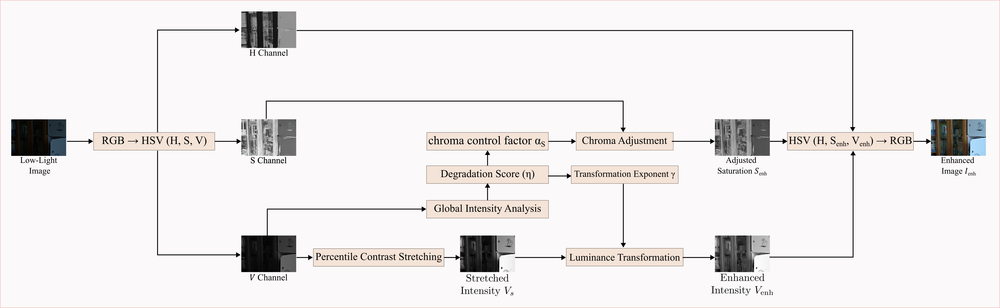
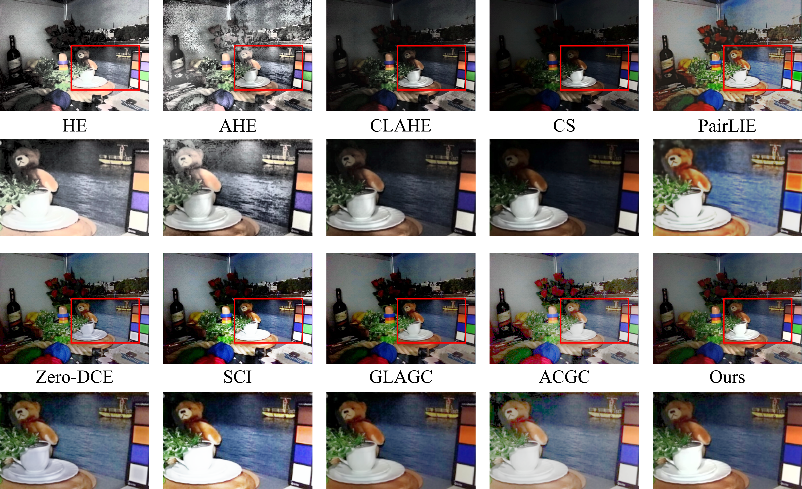
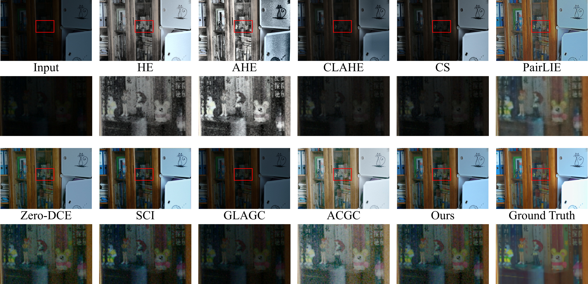
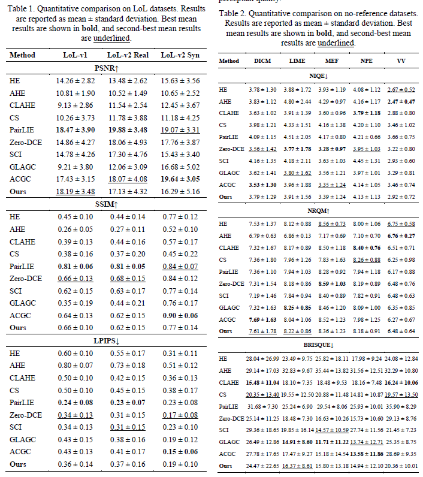

# SGCIM: Statistics-Guided Chroma and Intensity Modulation for Low-Light Image Enhancement

---
# Abstract

Low-light image enhancement (LLIE) aims to improve visibility in poorly illuminated scenes, where compressed dynamic range and weak contrast obscure image content. In this work, we present Statistics-Guided Chroma and Intensity Modulation (SGCIM), a training-free method that coordinates intensity and chroma adjustment through a single image-dependent degradation score. The score combines brightness, entropy, and contrast statistics computed from the HSV value channel. An exponential mapping determines the gamma exponent for a power-law transformation applied after percentile-based contrast stretching. The same score controls saturation scaling, while the original hue is preserved. Experiments on three paired benchmarks show higher mean PSNR and lower mean LPIPS than the evaluated classical baselines. On five no-reference benchmarks, SGCIM preserves input lightness ordering more closely than the evaluated recent methods and obtains favorable NRQM and BRISQUE results on several datasets. SGCIM also demonstrates competitive computational efficiency in CPU-based processing.


---

# Method Pipeline




---

# Installation

```bash
pip install torch torchvision
pip install opencv-python
pip install numpy
pip install scikit-image
pip install pyiqa
```

---

# Main Script Usage Guide

This guide covers the main ways to run `main.py` for SGCIM enhancement, single-folder evaluation, batch evaluation, and enhancement-plus-evaluation pipeline runs.

## Expected File Layout

Place the launcher and supporting scripts in the same directory:

```text
main.py
SGCIM.py
eval.py
infer.py
```

## Common Arguments

| Argument | Used In | Purpose |
|---|---|---|
| `enhance` | command | Enhance one image folder with SGCIM. |
| `pipeline` | command | Enhance one folder, then optionally evaluate the enhanced output. |
| `eval-single` | command | Evaluate one output folder with reference or no-reference metrics. |
| `eval-batch` | command | Evaluate structured multi-dataset outputs. |
| `--input` | `enhance`, `pipeline` | Input low-light image folder. |
| `--output` | `enhance`, `pipeline`, `eval-single` | Output folder for enhanced images, or existing enhanced image folder for evaluation. |
| `--recursive` | `enhance`, `pipeline` | Process images inside subfolders. |
| `--low-pct` | `enhance`, `pipeline` | Low percentile for luminance stretching. Default: `1.0`. |
| `--high-pct` | `enhance`, `pipeline` | High percentile for luminance stretching. Default: `99.0`. |
| `--gt` | `pipeline`, `eval-single` | Ground-truth folder for reference evaluation. |
| `--csv` | `pipeline`, `eval-single` | Optional CSV save path for single-folder evaluation. |
| `--mode` | `eval-single`, `eval-batch` | Evaluation mode. Single: `auto`, `reference`, `no_reference`. Batch: `all`, `reference`, `no_reference`. |
| `--eval-mode` | `pipeline` | Evaluation mode after enhancement: `auto`, `reference`, `no_reference`, or `none`. |
| `--results-root` | `eval-batch` | Root folder containing `reference/` and/or `no_reference/` result groups. |
| `--gt-root` | `eval-batch` | GT root folder for batch reference evaluation. |
| `--save-root` | `eval-batch` | Folder where batch CSV summaries are saved. Default: `eval_csv`. |
| `--map` | `eval-batch` | Dataset-name mapping in `result_dataset=gt_dataset` format. Can be repeated. |
| `--ref-metrics` | `pipeline`, `eval-single`, `eval-batch` | Optional reference metrics. Default: `psnr ssim lpips`. |
| `--nr-metrics` | `pipeline`, `eval-single`, `eval-batch` | Optional no-reference metrics. Single default: `niqe nrqm brisque musiq`; batch default: `niqe nrqm brisque`. |


## Quick Run Tables

Click the usage name in the first column to jump to the related sample command.

### Single-Dataset Runs

| Usage | Command | Evaluation | Main Purpose |
|---|---:|---:|---|
| [Enhancement Only](#enhance-only) | `enhance` | Skipped | Generate SGCIM enhanced images. |
| [Recursive Enhancement Only](#recursive-enhance-only) | `enhance` | Skipped | Enhance images inside nested folders. |
| [Enhancement + Reference Evaluation](#pipeline-reference) | `pipeline` | Reference | Generate enhanced images and evaluate with GT images. |
| [Enhancement + No-Reference Evaluation](#pipeline-noref) | `pipeline` | No-reference | Generate enhanced images and evaluate without GT. |
| [Enhancement + Evaluation Skipped](#pipeline-no-eval) | `pipeline` | Skipped | Run the pipeline but skip evaluation. |
| [Evaluation Only, Reference](#eval-only-reference) | `eval-single` | Reference | Evaluate already-generated SGCIM output with GT. |
| [Evaluation Only, No-Reference](#eval-only-noref) | `eval-single` | No-reference | Evaluate already-generated SGCIM output without GT. |
| [Custom Percentile Enhancement](#custom-percentile-enhancement) | `enhance` | Skipped | Tune the luminance stretch percentiles. |
| [Custom Metric Evaluation](#custom-metric-evaluation) | `eval-single` | Reference or no-reference | Evaluate using a selected metric list. |

### Multi-Dataset Runs

| Usage | Command | Evaluation | Main Purpose |
|---|---:|---:|---|
| [Batch Evaluation Only, Reference](#batch-eval-reference) | `eval-batch` | Reference | Evaluate `results/reference` using `gt_root`. |
| [Batch Evaluation Only, No-Reference](#batch-eval-noref) | `eval-batch` | No-reference | Evaluate `results/no_reference` without GT. |
| [Batch Evaluation Only, All](#batch-eval-all) | `eval-batch` | Both | Evaluate both reference and no-reference result groups. |
| [Batch Evaluation With Custom GT Mapping](#batch-eval-custom-map) | `eval-batch` | Reference or all | Map result dataset names to GT folder names. |
| [Batch Evaluation With Custom Metrics](#batch-eval-custom-metrics) | `eval-batch` | Reference or no-reference | Run batch evaluation with selected metric lists. |

### Recommended Shortcuts

| Usage | Best For | Link |
|---|---|---|
| Single reference benchmark | Datasets with paired GT images | [Go to command](#pipeline-reference) |
| Single no-reference benchmark | Datasets without GT images | [Go to command](#pipeline-noref) |
| Enhancement only | Fast inference without metric computation | [Go to command](#enhance-only) |
| Multi-dataset benchmark | Structured result folders | [Go to command](#batch-eval-all) |


---
# Results

For reproducibility and detailed visual comparison, all enhancement results are publicly available at: [google_drive](https://drive.google.com/drive/folders/1RiaRJIVir0bhQj_gd0BExj2iuwgOjdeg?usp=sharing)


## Visual Comparison with SOTA Methods





## Quantitative Results on Referenced and No Reference Low-Light Datasets



---


# Command Selection

SGCIM uses one enhancement method. The main script is organized by command:

```text
python main.py enhance      # Enhancement only
python main.py pipeline     # Enhancement followed by optional evaluation
python main.py eval-single  # Evaluation of one output folder
python main.py eval-batch   # Evaluation of structured multi-dataset outputs
```

---

# Single-Dataset Workflows

Use these commands when working with one dataset at a time.

<a id="enhance-only"></a>
## Enhancement Only

Use this when you only want to generate enhanced images.

```bash
python main.py enhance \
  --input dataset/lol_v1/low \
  --output output/lol_v1/SGCIM
```

<a id="recursive-enhance-only"></a>
## Recursive Enhancement Only

Use `--recursive` when the input folder contains image subfolders.

```bash
python main.py enhance \
  --input dataset/mixed_low_light \
  --output output/mixed_low_light/SGCIM \
  --recursive
```

<a id="pipeline-reference"></a>
## Enhancement + Reference Evaluation

Use this when you have ground-truth images.

```bash
python main.py pipeline \
  --input dataset/lol_v1/low \
  --output output/lol_v1/SGCIM \
  --gt dataset/lol_v1/high \
  --csv output/lol_v1/SGCIM/results.csv
```

<a id="pipeline-noref"></a>
## Enhancement + No-Reference Evaluation

Use this when there is no ground-truth folder.

```bash
python main.py pipeline \
  --input dataset/lime \
  --output output/lime/SGCIM \
  --eval-mode no_reference \
  --csv output/lime/SGCIM/results.csv
```

<a id="pipeline-no-eval"></a>
## Enhancement + Evaluation Skipped

Use `--eval-mode none` when you want the pipeline command to enhance images only.

```bash
python main.py pipeline \
  --input dataset/lol_v1/low \
  --output output/lol_v1/SGCIM \
  --eval-mode none
```

<a id="eval-only-reference"></a>
## Evaluation Only, Reference

Use this when enhanced outputs already exist.

```bash
python main.py eval-single \
  --output output/lol_v1/SGCIM \
  --gt dataset/lol_v1/high \
  --csv output/lol_v1/SGCIM/results.csv
```

`eval-single` uses `--mode auto` by default. If `--gt` is provided, reference evaluation is used automatically.

<a id="eval-only-noref"></a>
## Evaluation Only, No-Reference

Use this when enhanced outputs already exist and there is no GT folder.

```bash
python main.py eval-single \
  --output output/lime/SGCIM \
  --mode no_reference \
  --csv output/lime/SGCIM/results.csv
```

<a id="custom-percentile-enhancement"></a>
## Custom Percentile Enhancement

Use `--low-pct` and `--high-pct` to control the percentile stretch applied to the luminance channel.

```bash
python main.py enhance \
  --input dataset/lol_v1/low \
  --output output/lol_v1/SGCIM_custom \
  --low-pct 0.5 \
  --high-pct 99.5
```

<a id="custom-metric-evaluation"></a>
## Custom Metric Evaluation

Reference metrics:

```bash
python main.py eval-single \
  --output output/lol_v1/SGCIM \
  --gt dataset/lol_v1/high \
  --csv output/lol_v1/SGCIM/results_ref.csv \
  --ref-metrics psnr ssim lpips
```

No-reference metrics:

```bash
python main.py eval-single \
  --output output/lime/SGCIM \
  --mode no_reference \
  --csv output/lime/SGCIM/results_nr.csv \
  --nr-metrics niqe nrqm brisque musiq
```

---

# Multi-Dataset Workflows

Use these commands when evaluating several datasets in a structured `results_root`.

## Multi-Dataset Output Structure

`eval-batch` expects outputs to be organized like this:

```text
results/
  reference/
    dataset_name/
      method_name/
        images
  no_reference/
    dataset_name/
      method_name/
        images
```

For SGCIM, the method folder can simply be named `SGCIM`:

```text
results/
  reference/
    lol_v1/
      SGCIM/
        images
  no_reference/
    lime/
      SGCIM/
        images
```

CSV summaries are saved like this:

```text
eval_csv/
  reference/
    dataset_name.csv
  no_reference/
    dataset_name.csv
```

<a id="batch-eval-reference"></a>
## Batch Evaluation Only, Reference

Use this when `results_root` already contains generated reference outputs.

```bash
python main.py eval-batch \
  --results-root results \
  --gt-root dataset \
  --save-root eval_csv \
  --mode reference
```

<a id="batch-eval-noref"></a>
## Batch Evaluation Only, No-Reference

Use this when `results_root` already contains generated no-reference outputs.

```bash
python main.py eval-batch \
  --results-root results \
  --save-root eval_csv \
  --mode no_reference
```

<a id="batch-eval-all"></a>
## Batch Evaluation Only, All

Use this when `results_root` already contains both reference and no-reference outputs.

```bash
python main.py eval-batch \
  --results-root results \
  --gt-root dataset \
  --save-root eval_csv \
  --mode all
```

<a id="batch-eval-custom-map"></a>
## Batch Evaluation With Custom GT Mapping

Use `--map` when the result dataset folder name and GT dataset folder name are different.

```bash
python main.py eval-batch \
  --results-root results \
  --gt-root dataset \
  --save-root eval_csv \
  --mode reference \
  --map lol_v1=lolv1 \
  --map lol_v2_real=lol_v2_real
```

This maps:

```text
results/reference/lol_v1/SGCIM/images  ->  dataset/lolv1/images
results/reference/lol_v2_real/SGCIM/images  ->  dataset/lol_v2_real/images
```

<a id="batch-eval-custom-metrics"></a>
## Batch Evaluation With Custom Metrics

Reference batch evaluation:

```bash
python main.py eval-batch \
  --results-root results \
  --gt-root dataset \
  --save-root eval_csv \
  --mode reference \
  --ref-metrics psnr ssim lpips
```

No-reference batch evaluation:

```bash
python main.py eval-batch \
  --results-root results \
  --save-root eval_csv \
  --mode no_reference \
  --nr-metrics niqe nrqm brisque
```

---

# Combined Enhancement + Batch Evaluation Workflow

`main.py` does not generate multi-dataset result trees directly. To run a full multi-dataset benchmark, first enhance each dataset into the expected structure, then run `eval-batch`.

## Step 1: Generate Reference Dataset Output

```bash
python main.py enhance \
  --input dataset/lol_v1/low \
  --output results/reference/lol_v1/SGCIM
```

## Step 2: Generate No-Reference Dataset Output

```bash
python main.py enhance \
  --input dataset/lime \
  --output results/no_reference/lime/SGCIM
```

## Step 3: Run Batch Evaluation

```bash
python main.py eval-batch \
  --results-root results \
  --gt-root dataset \
  --save-root eval_csv \
  --mode all
```

---

# Recommended Commands

## Single Reference Benchmark

Use this for paired datasets with low-light inputs and GT targets:

```bash
python main.py pipeline \
  --input dataset/lol_v1/low \
  --output output/lol_v1/SGCIM \
  --gt dataset/lol_v1/high \
  --csv output/lol_v1/SGCIM/results.csv
```

## Single No-Reference Benchmark

Use this for datasets without GT targets:

```bash
python main.py pipeline \
  --input dataset/lime \
  --output output/lime/SGCIM \
  --eval-mode no_reference \
  --csv output/lime/SGCIM/results.csv
```

## Enhancement Only

```bash
python main.py enhance \
  --input dataset/lol_v1/low \
  --output output/lol_v1/SGCIM
```

## Multi-Dataset Evaluation

```bash
python main.py eval-batch \
  --results-root results \
  --gt-root dataset \
  --save-root eval_csv \
  --mode all
```
